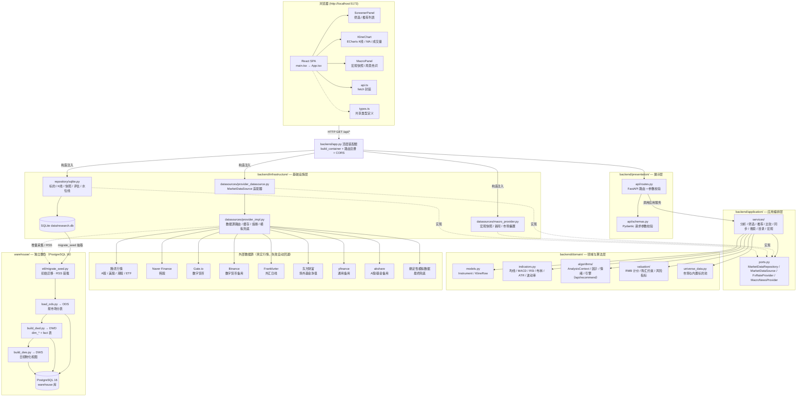
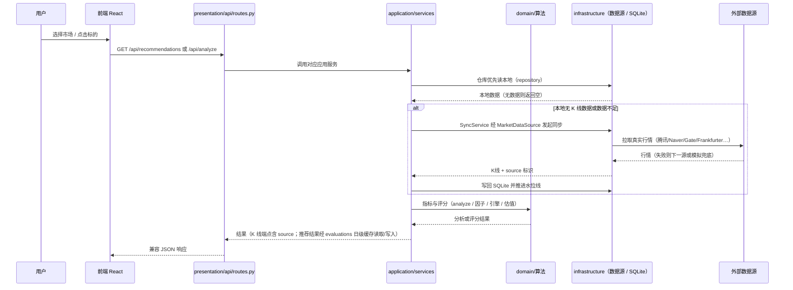

# Global Finance Research Terminal — 系统架构图

> 基于当前代码（`backend/` + `frontend/`）生成的架构说明，与实现同步。

## 总体架构

系统采用依赖倒置的分层单体，四层依赖方向严格向下：展示层 → 应用层 → 领域/算法层；基础设施层实现应用层端口，由装配根注入。`backend/core/` 兼容层已移除。



## 依赖规则

- 展示层只调用应用层接口，不直接 import `datasources`、`repository` 或数据库实现。
- 应用层依赖领域模型和端口协议，负责把数据、算法与约束编排成用例。
- 领域/算法层只依赖自身的值对象与纯函数，不 import 数据源、数据库、FastAPI 或任何网络模块。
- 基础设施层实现 `application/ports.py` 中的端口，由顶层 `app.py` 的 `build_container()` 在运行时构造并注入。

## 请求数据流



## 关键设计

| 关注点 | 实现 |
|---|---|
| **依赖方向** | `presentation/` → `application/` → `domain/`；`infrastructure/` 实现 `application/ports.py` 端口并由装配根注入 |
| **多市场路由** | `infrastructure/datasources/provider_impl.py` 按市场选择主源：A股/美股/港股/场内 ETF 与基金→腾讯，韩股→Naver，数字货币→Gate.io，外汇→Frankfurter，场外基金→东方财富 |
| **高可用降级** | 主源失败 → 备用源（yfinance/akshare/Binance）→ 确定性模拟数据，`source` 字段标识 `live`/`mock`/`local` |
| **性能与持久化** | 外部行情 5 分钟内存缓存 + 失败源 120 秒熔断；K 线、推荐结果与同步水位线落 SQLite，首页推荐按自然日缓存；全市场候选按市场缓存 1 小时（兜底 60 秒） |
| **增量同步** | `SyncService` 读 `sync_watermarks` 确定同步起止并写回 SQLite，写库成功后推进水位线；当前 `ProviderDataSource` 按 `limit` 拉取后在适配器内按时间过滤 |
| **评分模型** | `/api/screen` 与 `/api/recommendations` 使用 `domain/indicators.py` 的固定加权评分；`/api/recommend` 走 `domain/algorithms/` 的可插拔因子/情绪/引擎链 |
| **推荐解释** | 每个标的附加权原因（技术指标/宏观/地缘/资金流/政策/行业/风险） |
| **CORS** | FastAPI 全放开，便于前端 5173 ↔ 后端 8000 跨端口调试 |
| **兼容 API** | 除 `/api/recommend` 已改为因子分/情绪/综合评分新结构外，其余路由字段结构保持兼容；K 线 `source` 取值由 `live`/`mock` 扩展出 `local`，前端 `types.ts` 仍为 `live | mock`，待前端同步 |

## 四层职责

### 展示层 — `backend/presentation/`

| 模块 | 职责 |
|---|---|
| `api/routes.py` | FastAPI 路由：参数校验、调用应用服务、返回兼容响应 |
| `api/schemas.py` | Pydantic 请求参数与范围校验 |
| `dependencies.py` | 从服务容器取依赖，供路由与测试使用 |

### 应用层 — `backend/application/`

| 模块 | 职责 |
|---|---|
| `ports.py` | 端口协议：`MarketDataRepository` / `MarketDataSource` / `FxRateProvider` / `MacroNewsProvider` |
| `config.py` | `AppConfig`：数据库路径、缓存 TTL、熔断时长 |
| `services/analysis_service.py` | 单标的 K 线、指标分析与兼容 `recommend` |
| `services/screening_service.py` | 按条件筛选与评分 |
| `services/recommendation_service.py` | 跨市场推荐与日级评估缓存 |
| `services/comparison_service.py` | 跨资产 RMB 口径比较 |
| `services/sync_service.py` | 增量同步与水位线维护 |
| `services/symbol_resolver.py` / `search_service.py` / `catalog_service.py` / `macro_service.py` | 代码识别、搜索、目录、宏观编排 |

### 领域/算法层 — `backend/domain/`

| 模块 | 职责 |
|---|---|
| `models.py` | `Instrument` / `KlineRow` 冻结值对象 |
| `indicators.py` | 纯函数指标：均线、MACD、RSI、布林、ATR、年化波动 |
| `universe_data.py` | 市场元数据与内置标的池 |
| `valuation/` | RMB 计价（`currency.py`）、购汇约束（`constraints.py`）、风险指标（`metrics.py`）；汇率由应用层注入 |
| `algorithms/` | 供 `/api/recommend` 使用的 `AnalysisContext` + 因子/情绪/引擎注册表 + `build_engine` 工厂；不 import 数据源、不发起网络请求 |

### 基础设施层 — `backend/infrastructure/`

| 模块 | 职责 |
|---|---|
| `datasources/provider_datasource.py` | 把 provider 实现适配成 `MarketDataSource` 端口 |
| `datasources/provider_impl.py` | 真实源路由、熔断、内存缓存、确定性模拟兜底、全市场候选发现 |
| `datasources/macro_provider.py` / `macro_data.py` | 宏观快照、新闻与市场偏置 |
| `repository/sqlite.py` | SQLite 仓库：`instruments` / `klines` / `market_snapshots` / `evaluations` / `sync_watermarks`；应用当前写入 K 线、推荐结果与同步水位线，`instruments` / `market_snapshots` 表结构就绪 |

### 顶层装配根 — `backend/app.py`

| 模块 | 职责 |
|---|---|
| `app.py` | `build_container()` 组装 repository/datasource/services，注册路由，不承载业务逻辑 |

## SQLite 数据模型

```sql
CREATE TABLE instruments (
  market TEXT NOT NULL,
  symbol TEXT NOT NULL,
  name TEXT NOT NULL,
  currency TEXT NOT NULL,
  sector TEXT,
  base_risk REAL,
  liquidity REAL,
  updated_at TEXT NOT NULL,
  PRIMARY KEY (market, symbol)
);

CREATE TABLE klines (
  market TEXT NOT NULL,
  symbol TEXT NOT NULL,
  period TEXT NOT NULL,
  time TEXT NOT NULL,
  open REAL NOT NULL,
  high REAL NOT NULL,
  low REAL NOT NULL,
  close REAL NOT NULL,
  volume REAL NOT NULL,
  PRIMARY KEY (market, symbol, period, time)
);

CREATE TABLE market_snapshots (
  date TEXT NOT NULL,
  market TEXT NOT NULL,
  symbol TEXT NOT NULL,
  name TEXT NOT NULL,
  turnover REAL,
  market_cap REAL,
  rank INTEGER NOT NULL,
  PRIMARY KEY (date, market, symbol)
);

CREATE TABLE evaluations (
  evaluated_on TEXT NOT NULL,
  market TEXT NOT NULL,
  symbol TEXT NOT NULL,
  score REAL NOT NULL,
  payload TEXT NOT NULL,
  PRIMARY KEY (evaluated_on, market, symbol)
);

CREATE TABLE sync_watermarks (
  market TEXT NOT NULL,
  symbol TEXT NOT NULL,
  period TEXT NOT NULL,
  as_of TEXT NOT NULL,
  PRIMARY KEY (market, symbol, period)
);
```

## 数仓（warehouse/）

独立 OLAP 数仓子项目，纯 PostgreSQL 16（Docker Compose 启动），与业务应用解耦；业务 API 暂不消费数仓，先完成数据采集、建模、装载与质量校验。

- **ODS 贴源层**：按市场分表（`ods_klines_a_share / fund / us / kr / hk / fx / crypto` + `ods_news`），保留 `raw_payload`，以幂等键去重。
- **DWD 明细层**：`dim_date / dim_market / dim_instrument / dim_provider` + `fact_kline`（按 `time` 范围分区）/ `fact_news`；多 provider 按优先级取主源。
- **DWS 汇总层**：`dws_instrument_daily` / `dws_market_daily` 日频物化视图。
- **ETL**：`migrate_seed.py` 从 `research.db` 与数据源抽取 → `load_ods.py` → `build_dwd.py` → `build_dws.py`；每日增量由 `sync_incremental.py` 按 `etl_watermarks` 水位线只装载新增 K 线/新闻，ODS/DWD/新闻与水位线推进同事务，失败回滚不推进水位线，事务提交后再刷新 DWS。

## 启动拓扑

```text
┌─────────────┐   HTTP/JSON   ┌──────────────┐   HTTPS    ┌──────────────────┐
│ Vite dev    │ ────────────▶ │ FastAPI      │ ─────────▶ │ 腾讯/Naver/Gate/  │
│ :5173       │               │ :8000        │            │ Frankfurter/东财  │
└─────────────┘               └──────────────┘            └──────────────────┘
```

- 后端：`python -m uvicorn app:app --reload --port 8000`
- 前端：`pnpm dev` → `http://localhost:5173`
- 数仓：`docker compose -f warehouse/docker-compose.yml up -d db` → PostgreSQL 16 `:5432`
